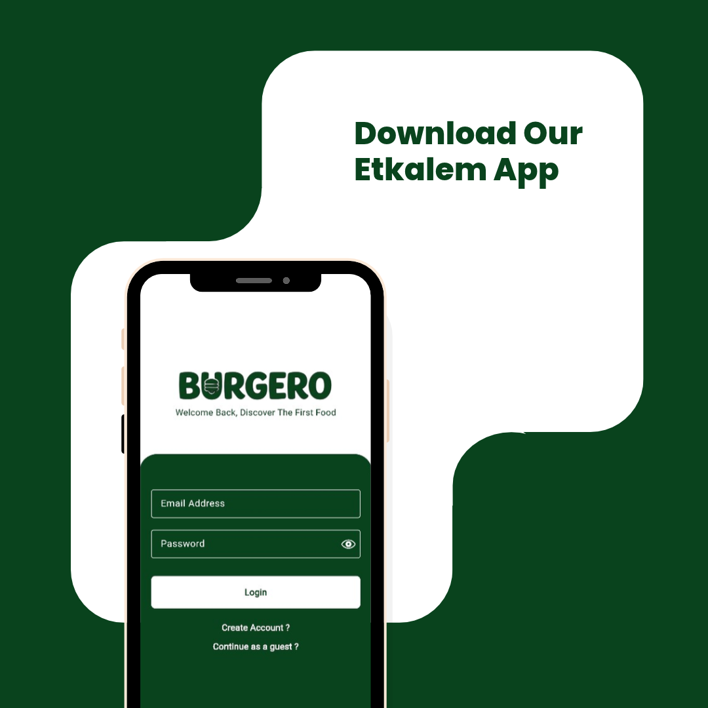
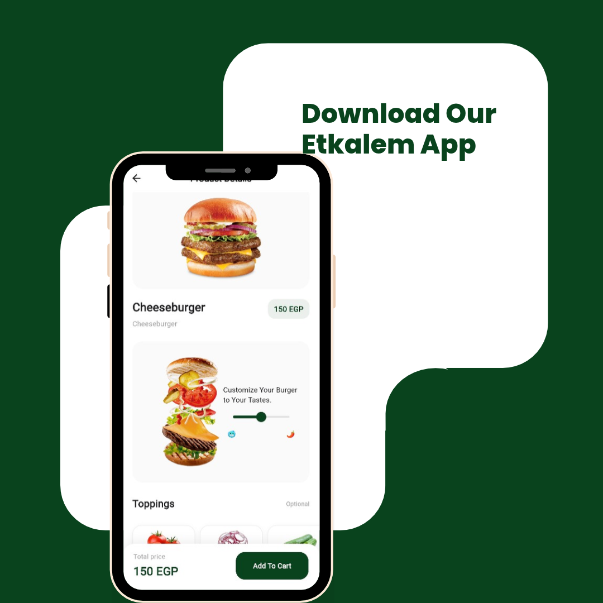
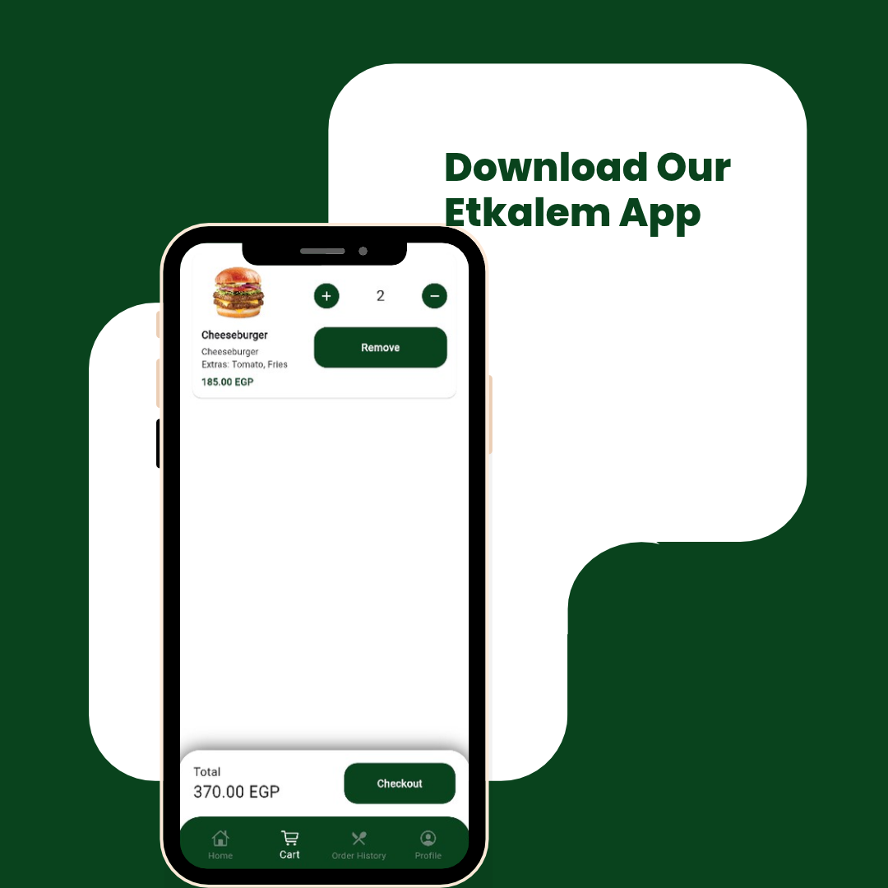
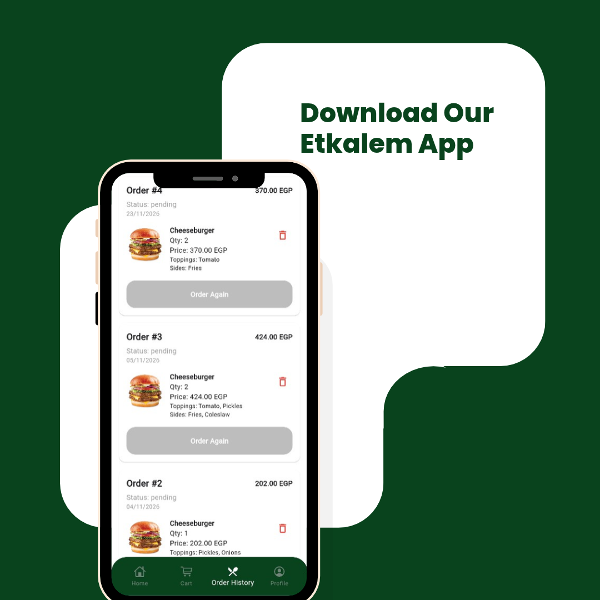

# 🍔 Burgero

**Burgero** is a Flutter-based food ordering application that provides users with a simple and convenient way to browse food products, manage their cart, and place orders.

## 📸 Screenshots

| Splash | Login | Home |
|:------:|:-----:|:----:|
|  |  |  |

| Product Details | Cart | Order History |
|:---------------:|:----:|:-------------:|
|  |  |  |

## ✨ Features

- **User Authentication:** Sign up and log in.
- **Product Browsing:** Fetch and display available food products.
- **Category Filter:** Filter products by category.
- **Shopping Cart:** Add products and manage cart items.
- **Checkout:** Place orders through the application.
- **Order History:** View previous orders and manage order items.
- **Profile & Settings:** Manage user profile and app settings.
- **Cloud Database:** Store and manage application data using Supabase.

## 🛠️ Tech Stack

- **Flutter** – Cross-platform UI development.
- **Dart** – Programming language.
- **Supabase** – Backend and database integration.
- **Flutter BLoC / Cubit** – State management.
- **Shared Preferences** – Local data storage.

## 📦 Dependencies

Main packages used in this project:

- `supabase_flutter`
- `flutter_bloc`
- `shared_preferences`
- `gap`
- `cupertino_icons`

## 🚀 Getting Started

### Prerequisites

- Flutter SDK
- Dart SDK
- Android Studio or Visual Studio Code
- A Supabase project

### Installation

1. Clone the repository:

   ```bash
   git clone https://github.com/Fodzoo/Burgero.git
   ```

2. Navigate to the project directory:

   ```bash
   cd Burgero
   ```

3. Install dependencies:

   ```bash
   flutter pub get
   ```

4. Configure your Supabase project URL and Publishable Key in `lib/main.dart`.

5. Run the application:

   ```bash
   flutter run
   ```

## 📁 Project Structure

The application follows a feature-based folder structure:

```text
lib/
├── core/
│   ├── constants/
│   ├── network/
│   ├── theme/
│   └── utils/
├── features/
│   ├── auth/
│   ├── cart/
│   ├── chekout/
│   ├── home/
│   ├── order_history/
│   ├── product/
│   └── settings/
├── shared/
├── main.dart
├── root.dart
└── splash.dart
```

## 🔐 Security

- Uses Supabase Publishable Key for client-side initialization.
- Database access should be protected using Row Level Security (RLS) policies.
- Never expose Supabase Secret Keys or `service_role` credentials in the client application.

## 👨‍💻 Developer

**Fodzoo**

GitHub: [@Fodzoo](https://github.com/Fodzoo)

---

*Built with Flutter ❤️*